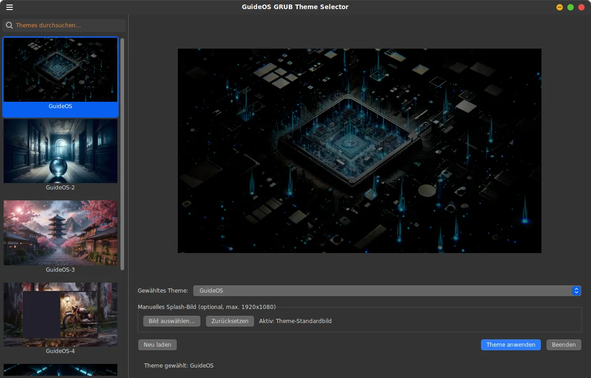

## ✨ Overview
### Grafischer GTK3 Grub-Theme-Manager mit Galerie-Vorschau
- Ein komfortables Werkzeug zum Verwalten von Grub-Bootloader-Themes.
- Das Programm zeigt Thumbnails aus /boot/grub/themes/ in einer klickbaren Galerie an
- und ermöglicht den Wechsel von Themes und Splash-Screens.

  

